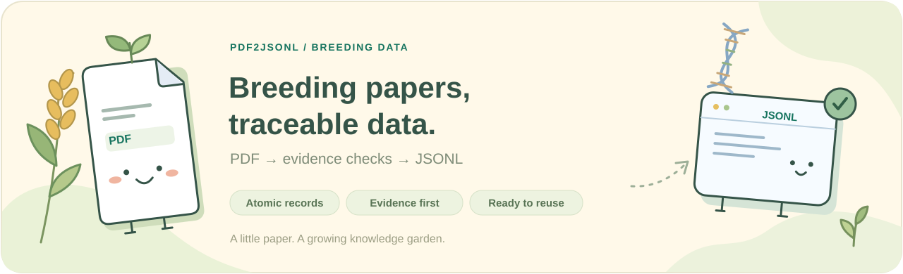
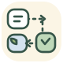
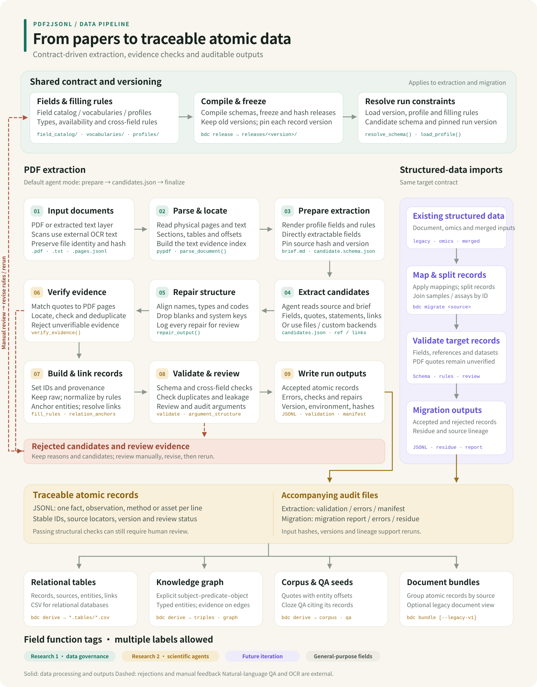

# 🌾 pdf2jsonl

[简体中文](README.md) | **English**



A data contract and extraction toolkit for **breeding literature**. Turn papers into atomic JSONL records with
traceable evidence, explicit field definitions, and versioned validation rules, then derive a knowledge graph,
a corpus, QA seeds and relational tables from the same records.

<table>
<tr>
<td align="center" width="25%">
<a href="https://atoz03.github.io/pdf2jsonl/papers.html"><br><strong>Paper dashboard</strong></a><br><sub>Papers & run history</sub>
</td>
<td align="center" width="25%">
<a href="https://atoz03.github.io/pdf2jsonl/fields.html"><br><strong>Field guide</strong></a><br><sub>Definitions & examples</sub>
</td>
<td align="center" width="25%">
<a href="https://atoz03.github.io/pdf2jsonl/pipeline.html"><br><strong>Pipeline map</strong></a><br><sub>From PDF to records</sub>
</td>
<td align="center" width="25%">
<a href="#quick-start"><br><strong>Start extracting</strong></a><br><sub>Run your first paper</sub>
</td>
</tr>
</table>

> 🌱 The repository maintains the data contract; the Skill runs extraction; every record keeps its source.

> Want to extract your own paper instead of the examples? Jump to [Extract your own papers](#-extract-your-own-papers).

> **Current version: 4.0.0.** New users only need this version: install it, pin `--schema-version 4.0.0`, and follow “Extract your own papers”. 3.x exists only for historical record compatibility; you do not need to install, migrate or follow the old commands.

**Everything is shown in one site:** [https://atoz03.github.io/pdf2jsonl](https://atoz03.github.io/pdf2jsonl/), built by `scripts/make_site.py` from the
latest release and the checked-in examples, and deployed from `main`.

| Page | What it shows |
| --- | --- |
| [Home](https://atoz03.github.io/pdf2jsonl/) | How a paper becomes traceable data: the whole project, its four kinds of downstream use, a tour of the site |
| [Pipeline](https://atoz03.github.io/pdf2jsonl/pipeline.html) | Every stage from contract, extraction, checks, assembly and validation to verification, derivation and review; how each candidate of the example paper fares; the poster (SVG, Chinese and English) |
| [Walk-through](https://atoz03.github.io/pdf2jsonl/demo.html) | The synthetic paper end to end: candidates, evidence checks, repairs, a rejection, the evidence-chain audit |
| [Outputs](https://atoz03.github.io/pdf2jsonl/outputs.html) | Statements, knowledge graph, research workflow, annotated corpus, QA seeds and tables derived from the same records |
| [Papers](https://atoz03.github.io/pdf2jsonl/papers.html) | Paper dashboard: the PDF, the records of each run, their evidence on the page, verification, review issues, downloads |
| [Importers](https://atoz03.github.io/pdf2jsonl/importers.html) | The legacy, omics and merged importers: mapping coverage, example runs, issue registers |
| [Fields](https://atoz03.github.io/pdf2jsonl/fields.html) | All **439 fields**: meaning, type, JSON example, key role, functions, multi-select tags, origin |
| [Contract](https://atoz03.github.io/pdf2jsonl/contract.html) | Record kinds, profiles, vocabularies, rules, the ambiguity register and the release history; records from every source (curated, pdf2jsonl, the three importers) side by side |

Preview locally with `make site` and open `_site/index.html`. `make dashboard` writes the **simplified research
view**: per-paper by default, showing only that paper's phenotype–gene–population relations, its complete
evidence chains and its article package; switch to the full network for cross-paper deduplication and A/B/C
confidence. Every other relation is counted but collapsed. Use `make dashboard-full` for the full paper
dashboard. `make network-demo` runs the four-paper demo and rebuilds `dashboard.html`.
The RBL1 association/primer demo is built with `make dashboard-rbl1`; it also writes
[`dashboard.html`](dashboard.html) with field-level evidence, the source manifest and 14 checks. Run
`make rbl1-aggregate` first to add four explicitly synthetic papers for the multi-paper overlay, including
A/B/C confidence, preserved contexts and a direction conflict.

For the real-paper panel run `make dashboard-panel`: it reads the 13 rice stress/disease papers under
`D:/新建文件夹/水稻-抗逆抗病性状` and builds a paper–trait graph plus trait + locus aggregation. Set
`RICE_PDF_DIR=...` to point at another directory; see
[examples/rice_stress_panel/README.md](examples/rice_stress_panel/README.md).

The view is backed by `src/breeding_contract/evidence_chain.py` (claim → result → experiment/method),
`src/breeding_contract/article_package.py` (article package) and `src/breeding_contract/aggregate.py`
(cross-paper clustering, conflicts and confidence); see [docs/research_view.md](docs/research_view.md).
The per-paper view also has a **人工复核 (N)** button that opens a review panel for every `pending_review`
record: approve / reject / return for evidence are kept in the browser, exported as JSON, and applied with
`bdc review apply RECORDS DECISIONS --out DIR`.

### Contract 4.0.0: association events and the RBL1 case

4.0.0 adds `association` / `sequence` record kinds, field-level evidence, a source-file manifest and alias
candidates. The RBL1 rice case (Nature 2023 + Supplementary Table 2) lives in
[examples/rbl1/](examples/rbl1/):

```bash
bdc rbl1 --pdf qt2321j386.pdf --primers examples/rbl1/primers.csv --out out/rbl1_case_final
```

It produces six exact primer sequences, three contextual associations, field-level evidence, a source manifest
and five downstream tables. See [docs/rbl1_case.md](docs/rbl1_case.md) and
[docs/association_contract.md](docs/association_contract.md). The PDF is not redistributed; source URLs and
SHA256 are in `examples/rbl1/README.md`.

## 🧭 Extract once, consume many times

```
paper (PDF) ── pdf2jsonl ───┐                            ┌─► statements · triples · graph   (knowledge graph)
(main text + supplements)   ├─► records (JSONL, hooks) ──┼─► research workflow (question → hypothesis → step → result)
existing data ─ bdc migrate ┘        bdc derive          ├─► corpus with entity offsets
                                                         ├─► cloze QA seeds
                                                         └─► relational tables (CSV)
```

A record is not a container for extraction results; it is the intermediate form every consumer shares. A
knowledge graph needs triples, so a record has an explicit subject, predicate and object. A corpus and a QA set
need to know where an entity stands in the text, so a record has the character offsets of every entity mention
and its role in the relation. No consumer parses the text a second time:

- **The model copies**: the three verbatim parts of a statement (`transform.subject_mention`,
  `predicate_mention`, `object_mention`).
- **The pipeline computes**: entity types, the offsets of entities and predicate in the quote, subject/object
  roles (`transform.entity_links`, `predicate_start_offset` / `predicate_end_offset`), and a relation code derived
  deterministically from a cue lexicon (`predicate_code`).
- **Reviewers and later stages add**: the reviewed predicate, entity alignment, natural-language QA. Each has
  its own field and is never mixed with extraction output.

Where a record has no hook, the derived output has no row: nothing is guessed. Design notes:
[`docs/downstream.md`](docs/downstream.md).

## 🧬 Data pipeline overview

[](docs/diagrams/pipeline.en.svg)

[HTML source](docs/diagrams/pipeline.html) · [Full-size SVG](docs/diagrams/pipeline.en.svg) · [Architecture](docs/architecture.md)

The diagram covers PDF extraction, imports of existing data, rejection and manual review paths, and the outputs:
relational tables, a knowledge graph, an evidence corpus with QA seeds, and document bundles. The HTML switches
languages and downloads the SVG. Run `make diagram` to regenerate both README images after editing the source.

## 📚 Inside the repository

| Path | What it is |
| --- | --- |
| `field_catalog/field_catalog.yaml` | **Canonical catalog**: every field, type, availability code, rule and ambiguity |
| `vocabularies/` | Controlled vocabularies and the deterministic unit table |
| `profiles/` | Field selections for one use case (`full`, `compact`, `pdf_extraction`, `pdf_extraction_omics`, `association_extraction`) |
| `releases/` | Frozen, hash-verified contract versions and `index.json` (`latest` pointer) |
| `schemas/meta/` | JSON Schemas for the source files themselves (catalog, vocabulary, profile, mapping) |
| `schemas/runtime/` | JSON Schemas for run outputs (manifest, validation report, error records, bundle, migration report, verification report) |
| `mappings/` | Leaf-by-leaf mappings from existing data formats to the contract, with issue registers; used by `bdc migrate` |
| `sources/` | Immutable original inputs (see `sources/SOURCES.md`) |
| `src/breeding_contract/` | Contract tooling: compile, release, resolve, validate, import, bundle, derive, audit, verify (`bdc` CLI) |
| `skills/pdf2jsonl/` | The Skill: `SKILL.md`, extraction brief template, runtime (`scripts/pdf2jsonl`) |
| `docs/` | Architecture, versioning, source analysis, importers, downstream outputs, key roles and functions; `docs/generated/` is built from the catalog (including the [field reference](docs/generated/field_definitions.md)) |
| `docs/field_examples.yaml` | Curated illustrative values used to generate and validate the field reference |
| `docs/field_classification.yaml` | Per-field multi-select tags: Research Content 1, Research Content 2, future iteration, and general-purpose fields |
| `scripts/make_site.py` / `site/` | Site builder and page templates: contract browser, paper dashboard (`scripts/make_dashboard.py`), downstream outputs, importers |
| `scripts/make_network_dashboard.py` / `site/pages/network.html` | Simplified research view: phenotype–gene–population only, QTL/QTN on the gene layer, other relations counted but collapsed; writes `dashboard.html` |
| `scripts/make_rbl1_dashboard.py` / `scripts/build_rice_stress_panel.py` | 4.0.0 RBL1 / real rice panel: association events, primers, field evidence, paper–trait graph and multi-paper aggregate |
| `examples/` | Synthetic papers, the RBL1 case, the 13-paper rice stress panel, pipeline output, migrations and derived views |
| `tests/` | pytest suite (catalog fidelity, releases, validation, pipeline, Skill sync, importers, bundles, functions, evidence chain, downstream hooks, workflow, verification, source parts, site) |

## 🔬 Contract at a glance (4.0.0)

- 439 fields in five groups: `common` 195, `agent` 64, `skills` 53, `transform` 59, `omics` 68.
  The 259 v3.0.0 fields are `verified` and verbatim; the 180 fields added since are `provisional`.
- **Multi-select functional tags**: Research Content 1, Research Content 2, future iteration, and general-purpose fields.
- Every key states **what it does** (`key_role`, 25 roles with their projection into graph, tables, triples and
  QA/corpora) and **which function it serves** (`serves`): Topic 2 agent, Topic 3 skills, derivation into
  KG / relational DB / QA / corpus / triples, and our own iteration (Topic 1). Topic 2/3 fields also name their
  card, and evidence-chain fields their Toulmin/Flavell element (after TRACE). Functions stated by the source
  are kept apart from repository additions. See `docs/field_functions.md`.
- Nested records: the field `common.record_id` is `{"common": {"record_id": ...}}`.
- Availability codes are semantics, not quality: **D** direct extraction, **N** normalized by rules,
  **I** human judgement, **G** generated later, **F** future source. Requirement codes **Y / C / N**.
- Missing information is **omitted**: no `null`, no empty string, no empty array or object.
- Every record carries `common.schema_name` and `common.schema_version`, a stable `common.record_id`
  (`rec_` + 32 hex), provenance (`source_id`, `source_locator`, page and verbatim quote for paper evidence),
  and a `review_status`.
- 37 cross-field rules (20 errors, 17 warnings): explicit source statements are errors, inferred ones are warnings only.
- 42 ambiguities are registered in the catalog (`AMB-001` … `AMB-042`) instead of being silently decided.
- `review_status` is a ladder: `pending_review` → `auto_validated` (deterministic checks) → `model_verified`
  (an independent verifier) → `expert_approved` / `rejected` (a person).

See the [online field catalog](https://atoz03.github.io/pdf2jsonl/fields.html), [field definitions and examples](docs/generated/field_definitions.md), the
[detailed dictionary](docs/generated/field_dictionary.md) (also [CSV](docs/generated/field_dictionary.csv);
`bdc generate --xlsx out.xlsx` for Excel), and
[field functions](docs/generated/field_functions.md) (every key by function, with its role and facets).

<a id="quick-start"></a>

## 🌱 Quick start

```bash
uv venv .venv && uv pip install --python .venv/bin/python -e '.[dev]'   # or: pip install -e '.[dev]'
make check        # bdc check --strict
make test         # pytest
```

## 🧪 Extract your own papers

The repository is not limited to its example papers. It does **not** call a model API by itself: it produces
`brief.md`, `pages.txt` and `candidate.schema.json`; you (or your agent) write `candidates.json`, then the
pipeline validates it, writes records and builds derived views.

### 1. Choose the profile and pin the version

| Goal | Profile | Notes |
|---|---|---|
| General paper records (phenotype, material, method, claim, …) | `pdf_extraction` | 4.x default, directly extracted D fields |
| Association events + primer sequences + field evidence | `association_extraction` | New in 4.0.0; for gene/QTL—trait—population—sequence papers such as RBL1 |

Pin `--schema-version 4.0.0` for reproducible experiments; do not use `latest` for long-lived runs.

### 2. Prepare a paper

```bash
python -m venv .venv
source .venv/bin/activate              # Windows: .venv\Scripts\activate
pip install -e '.[dev]'                # includes pypdf / openpyxl

# The commands below use the installed pdf2jsonl console script. If it is not on PATH, run from the repo root:
# PYTHONPATH=src:skills/pdf2jsonl/scripts python -m pdf2jsonl_skill.cli prepare ...
# On Windows the PYTHONPATH separator is ;

pdf2jsonl prepare "papers/my-paper.pdf" \
  --profile association_extraction \
  --schema-version 4.0.0 \
  --out-dir out/my-paper \
  --work-dir out/my-paper/work

# one or more supplementary files:
pdf2jsonl prepare "papers/my-paper.pdf" \
  --supplement "papers/my-paper-supplement.pdf" \
  --profile association_extraction --schema-version 4.0.0 \
  --out-dir out/my-paper --work-dir out/my-paper/work
```

`prepare` writes to `out/my-paper/work/`:

- `brief.md`: the task, fields, rules and forbidden fields;
- `pages.txt`: page-numbered text;
- `candidate.schema.json`: the JSON Schema the agent must satisfy;
- `candidates.template.json`: output skeleton;
- `request.json`: input, version, profile and hashes.

For a PDF without a text layer, produce `.pages.jsonl` or `.txt` with OCR and pass `--text-layer`.

### 3. Let an agent/LLM write candidates.json

Give the agent `brief.md`, `pages.txt` and `candidate.schema.json`. It should write only `candidates.json`,
never final records. A reusable prompt:

```text
You are a literature extractor. Read only:
- <work>/brief.md
- <work>/pages.txt
- <work>/candidate.schema.json

Write <work>/candidates.json strictly against the schema:
1. Only direct-extraction fields allowed by the brief; never write system fields
   such as common.schema_version, record_id, record_grain or qc_rule_set_version.
2. Every candidate needs evidence: page and quote; the quote must be verbatim
   from that page.
3. Put unavailable fields in missing_fields using the brief's reason codes; do
   not guess or fill from background knowledge.
4. One research context per candidate; never merge different populations,
   environments or experiments.
5. Association events need study / population / trait / locus; primer sequences
   need name, 5'->3' text, direction, use and attachment cell locator.
6. Output JSON only, with no prose, Markdown or extra text.
```

### 4. Finalize, validate, inspect

```bash
pdf2jsonl finalize out/my-paper/work --out-dir out/my-paper

# output: my-paper.jsonl, my-paper.validation.json,
#         my-paper.errors.jsonl, my-paper.manifest.json
bdc validate out/my-paper/my-paper.jsonl
```

Add `--bundle` for the document bundle; add `--fail-on-reject` in CI to exit 2 when any candidate is rejected.
If another tool already produced candidates:

```bash
pdf2jsonl run "papers/my-paper.pdf" \
  --backend candidates --candidates out/my-paper/work/candidates.json \
  --profile association_extraction --schema-version 4.0.0 \
  --out-dir out/my-paper
```

`--backend mock` is for demos only, never for real papers. A custom Python extractor can be plugged in with
`--backend module:your_module:extract`; agent + `candidates` is the auditable default.

### 5. Batch papers

One `work/` directory per paper; never mix candidates from different papers:

```bash
for pdf in papers/*.pdf; do
  stem=$(basename "$pdf" .pdf)
  pdf2jsonl prepare "$pdf" \
    --profile pdf_extraction --schema-version 4.0.0 \
    --out-dir "out/$stem" --work-dir "out/$stem/work"
  # give each out/$stem/work to the agent, then:
  pdf2jsonl finalize "out/$stem/work" --out-dir "out/$stem"
done

bdc validate out/*/*.jsonl
make dashboard-full     # full paper dashboard
```

`make dashboard` is the simplified phenotype–gene–population network; use `make dashboard-full` for all
records, evidence and run history. The RBL1 multi-paper dashboard is a 4.0.0-specific view, not the default
page for arbitrary papers.

### 6. Can a conversation trigger this?

Only when the agent can read the repository and PDFs, run `pdf2jsonl prepare`/`finalize`, read `brief.md` and
write `candidates.json`, and run `bdc validate`. Otherwise use the CLI. A complete copyable reproduction /
batch prompt is in [REPRODUCE.md](REPRODUCE.md).

For Claude Code and other Skill-aware agents, `.claude/skills/pdf2jsonl` links to `skills/pdf2jsonl`; a
user-level install can symlink `~/.claude/skills/pdf2jsonl` to the same directory. The Skill still needs file
and terminal access; it only wraps the same `prepare`/`finalize` flow.

### Python API

```python
from breeding_contract import resolve_schema, load_profile, load_field_catalog, validate_record

rc = resolve_schema("4.0.0")                   # or "latest", or "dev" (unreleased working tree)
profile = load_profile("pdf_extraction", "latest")
catalog = load_field_catalog("4.0.0")
result = validate_record(record)               # validates against the version the record declares
result.valid, [i.to_dict() for i in result.errors]
```

### `bdc` CLI

| Command | Purpose |
| --- | --- |
| `bdc check [--strict]` | Consistency gate: catalog, profiles, releases, freshness, docs, examples, mappings, Skill |
| `bdc generate [--xlsx F]` | Rebuild `docs/generated/` from the catalog and documentation examples |
| `bdc release` | Freeze the working tree as `releases/<VERSION>` (needs a CHANGELOG entry) |
| `bdc resolve [--schema-version V] [--profile P]` | Print a version's identity (default `latest`) |
| `bdc validate FILE.jsonl` | Validate records (each against its declared version) plus dataset rules |
| `bdc diff A B` | Field-level diff between two versions |
| `bdc migrate legacy\|omics\|merged F --out DIR [--page-offset N]` | Import existing data as atomic records, see [Import existing data](#import) |
| `bdc bundle F.jsonl [--legacy-v1]` | Derive the per-document view (or the legacy v1 layout) from records |
| `bdc derive F.jsonl --out DIR` | Function 3: relational tables (CSV), statements, triples and a property graph, the research workflow, an annotated corpus and QA seeds, with their lineage |
| `bdc audit F.jsonl [--json]` | Evidence-chain audit (Toulmin/Flavell elements, link closure, review flags; no score) and workflow structure |
| `bdc verify tasks\|apply F.jsonl [VERDICTS] --out DIR` | Semantic verification by an independent verifier: build the tasks, then apply its verdicts to the review fields |
| `bdc review apply F.jsonl DECISIONS --out DIR` | Apply human/expert decisions (approve / reject / return for evidence); only `review_status` and `review_note` move; writes `.reviewed.jsonl` and `.review.json` |

## 🌿 Evolving the contract

1. Edit `field_catalog/field_catalog.yaml` (and vocabularies/profiles). Keep source references; mark new
   semantics `provisional` and register open questions as ambiguities.
2. Bump `VERSION` per `docs/versioning.md` and add a `CHANGELOG.md` entry.
3. Add or update illustrative values in `docs/field_examples.yaml` and functional tags in `docs/field_classification.yaml`; contract name and version examples are generated automatically.
4. `bdc generate && bdc release && bdc check --strict && pytest`. Generation checks that every field has an example and that examples match field schemas.
5. The Skill needs no edit: its next run resolves `latest` and renders the brief from the new release.
   `bdc check` fails if the Skill hard-codes field paths or versions, or if a profile needs a fill rule the
   Skill does not implement.

<a id="import"></a>

## 🌾 Import existing data

Data that already exists in another shape enters the same contract through an importer, not through a second
schema. Each importer follows a leaf-by-leaf mapping (`mappings/`) and produces the same atomic records as
extraction, validated the same way.

| Command | Input | Example |
| --- | --- | --- |
| `bdc migrate legacy` | Document-level JSONL, one paper per line | `sources/legacy_v1/breeding_jsonl_example.jsonl` |
| `bdc migrate omics` | Filled instances of the multi-omics metadata template | `examples/migration/omics_v2/synthetic_deg_instance.json` |
| `bdc migrate merged` | Documents with observation, sample, assay and asset arrays joined by explicit IDs | `sources/merged_v2/breeding_jsonl_example_v2.json` |

```bash
bdc migrate merged sources/merged_v2/breeding_jsonl_example_v2.json --out out/merged --page-offset 2220
```

`--page-offset` converts journal pages to physical PDF pages; `2220` applies only to this example, and `0` means
the pages are already physical. All three importers write the same outputs: valid records, rejected candidates
with reasons, unconverted source content (residue) and a hashed migration report. Nothing is dropped silently
and nothing is invented to fill a required field. Imported records start as `pending_review`. See
`docs/migration.md` for the importers and `docs/source_analysis.md` for how the sources differ.

## 🗂 Documentation

- `docs/downstream.md` — the record as a hub: the hooks consumers need, every output of `bdc derive`, source
  parts and incomplete papers, how the representations trace back to each other
- `docs/workflow.md` — the research workflow of a paper as roles and links between records
- `docs/review.md` — the three layers of checking, `bdc verify`, what experts decide
- [Field definitions and JSON examples](docs/generated/field_definitions.md) — generated reference for all fields
- `docs/architecture.md` — components, data flow, pipeline stages, invariants
- `docs/versioning.md` — semantic versioning of the contract, releases, `latest`/`dev`, compatibility
- `docs/source_analysis.md` — the source designs, their inconsistencies and the merge decisions
- `docs/migration.md` — the three importers, the mapping files and the derived views (`document_bundle`, `bdc derive`)
- `docs/field_functions.md` — what every key is for: roles, the four functions, cards, the evidence chain (TRACE),
  derived views and the audit
