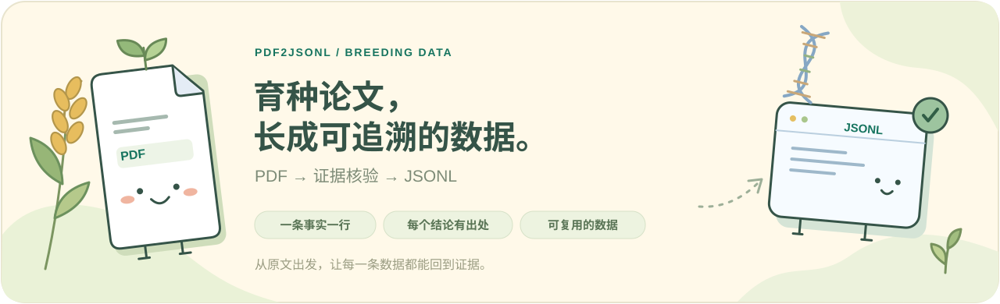
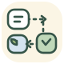
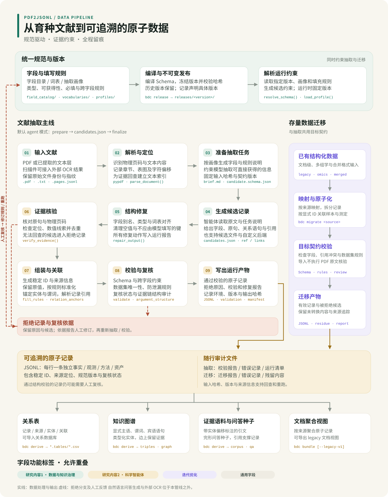

# 🌾 pdf2jsonl

**简体中文** | [English](README.en.md)



从一篇育种论文出发，整理出**有原文证据、字段含义明确、能够回查的 JSONL 数据**；同一份数据再直接派生出
知识图谱、语料、问答种子和关系表。本仓库维护育种文献数据契约，并提供抽取、校验、导入和派生工具。

<table>
<tr>
<td align="center" width="25%">
<a href="https://atoz03.github.io/pdf2jsonl/papers.html"><br><strong>论文看板</strong></a><br><sub>看论文，也看每次运行</sub>
</td>
<td align="center" width="25%">
<a href="https://atoz03.github.io/pdf2jsonl/fields.html"><br><strong>字段图鉴</strong></a><br><sub>含义、功能标签与示例</sub>
</td>
<td align="center" width="25%">
<a href="https://atoz03.github.io/pdf2jsonl/pipeline.html"><br><strong>管线地图</strong></a><br><sub>从 PDF 到原子记录</sub>
</td>
<td align="center" width="25%">
<a href="#quick-start"><br><strong>开始抽取</strong></a><br><sub>用一篇论文跑起来</sub>
</td>
</tr>
</table>

> 🌱 仓库负责数据规范，Skill 负责抽取流程，每条记录都带着它的出处。

> 想抽取自己的论文，而不是跑示例？直接看 [用你自己的论文抽取](#-用你自己的论文抽取)。

> **当前版本：4.0.0。** 新用户只需要这一版：安装后固定 `--schema-version 4.0.0`，按“用你自己的论文抽取”操作即可。3.x 只用于历史记录兼容，不需要安装、迁移或按旧命令操作。

**所有内容都在一个站点里：** [https://atoz03.github.io/pdf2jsonl](https://atoz03.github.io/pdf2jsonl/) 由 `scripts/make_site.py`
根据最新发布版本和仓库内的示例生成，随 `main` 分支自动部署。

| 页面 | 内容 |
| --- | --- |
| [首页](https://atoz03.github.io/pdf2jsonl/) | 一篇论文怎样变成可回查的数据：项目全貌、四类下游用途和站内导览 |
| [管线](https://atoz03.github.io/pdf2jsonl/pipeline.html) | 规范、抽取、核验、组装、校验、语义校验、派生到复核的每一步；示例论文的每个候选怎样过关，附全景图（中英文 SVG） |
| [抽取演示](https://atoz03.github.io/pdf2jsonl/demo.html) | 合成论文从 PDF 到 JSONL 的全过程：候选、证据核验、修复、拒绝与证据链审计 |
| [下游派生](https://atoz03.github.io/pdf2jsonl/outputs.html) | 同一批记录派生出的关系语句、知识图谱、研究流程、带标注的语料、问答种子和关系表 |
| [论文看板](https://atoz03.github.io/pdf2jsonl/papers.html) | 按论文查看 PDF、每次运行的记录、原文证据、研究流程、语义校验与复核问题；校验提示按“取值核验 / 填写规则 / 记录链接 / 来源完整性”分组并可逐条筛选，结果可下载 |
| [存量导入](https://atoz03.github.io/pdf2jsonl/importers.html) | legacy、omics、merged 三种已有格式的导入器：映射覆盖、示例运行、问题登记 |
| [字段目录](https://atoz03.github.io/pdf2jsonl/fields.html) | **439 个字段**：含义、类型、JSON 示意、键角色、服务功能、功能分类标签（可多选）和来源 |
| [规范](https://atoz03.github.io/pdf2jsonl/contract.html) | 记录类型、画像、受控词表、填写规则、歧义登记和版本历史；各来源（人工整理、pdf2jsonl、三种导入）的记录并排对照 |

本地预览执行 `make site`，然后打开 `_site/index.html`。`make dashboard` 生成**简化研究视图**：
默认逐篇查看，每篇只保留“表型—基因—种群”三元关系、完整证据链和文章包；可切换到全库大网，
跨文去重并显示 A/B/C 置信。其他关系只计数、不展开。完整论文看板用 `make dashboard-full`。
`make network-demo` 会跑四篇合成论文的 demo 并重建 `dashboard.html`。
RBL1 关联事件 / 引物序列 demo 用 `make dashboard-rbl1`，同样生成根目录
[`dashboard.html`](dashboard.html)，包含字段级证据、来源清单和 14 项校验。多文聚合 demo 先运行
`make rbl1-aggregate`（加入 4 篇明确标注的合成论文），dashboard 会多出一个独立的“多文聚合”入口；
点击展开全库图，展示 A/B/C 置信、跨文上下文和方向冲突。

真实论文面板使用 `make dashboard-panel`：读取 `D:/新建文件夹/水稻-抗逆抗病性状` 下 13 篇水稻
抗逆/抗病论文，生成论文—性状关系图和按 trait + locus 聚合的关系；可用 `RICE_PDF_DIR=...` 指定目录。
说明见 [examples/rice_stress_panel/README.md](examples/rice_stress_panel/README.md)。

异地复现的完整步骤、验收字段和可复制的 agent 提示词见 [REPRODUCE.md](REPRODUCE.md)。

研究视图的后端模块是 `src/breeding_contract/evidence_chain.py`（结论→结果→实验/方法）、
`src/breeding_contract/article_package.py`（文章包清单）和 `src/breeding_contract/aggregate.py`
（跨文聚类、冲突与置信）；说明见 [docs/research_view.md](docs/research_view.md)。逐篇视图页头的
**人工复核（N）** 按钮打开复核面板：通过 / 驳回 / 退回补证先保存在浏览器，导出后由
`bdc review apply 记录文件 决定文件 --out 输出目录` 写回 `review_status` 和 `review_note`。

### 契约 4.0.0：关联事件与 RBL1 案例

4.0.0 新增 `association` / `sequence` 记录类型、字段级证据、来源文件清单和别名候选。
RBL1 水稻案例（Nature 2023 + Supplementary Table 2）放在 [examples/rbl1/](examples/rbl1/)：

```bash
bdc rbl1 --pdf qt2321j386.pdf --primers examples/rbl1/primers.csv --out out/rbl1_case_final
```

输出 6 条逐字符引物序列、3 条带研究上下文的关联、字段级证据、来源清单和五张下游表。说明见
[docs/rbl1_case.md](docs/rbl1_case.md) 与 [docs/association_contract.md](docs/association_contract.md)。
PDF 不随仓库分发；来源 URL 与 SHA256 写在 `examples/rbl1/README.md`。

## 🧭 一次抽取，多种下游

```
论文 PDF ── pdf2jsonl ──┐                          ┌─► 关系语句 · 三元组 · 属性图（知识图谱）
（正文 + 补充材料）     ├─► 记录（JSONL，带钩子）──┼─► 研究流程（问题 → 假设 → 步骤 → 结果）
已有数据 ── bdc migrate ┘        bdc derive        ├─► 带实体偏移标注的语料
                                                   ├─► 完形问答种子
                                                   └─► 关系表（CSV）
```

记录不是抽取结果的容器，而是下游共用的中间格式。知识图谱要三元组，记录里就有显式的主语、谓词、宾语；
语料和问答要知道实体在原文的位置，记录里就有每个实体提及的字符偏移和它在关系中的角色。下游不必对原文
再解析一遍：

- **模型只抄写**：关系的主语、谓词原文、宾语三段逐字文本（`transform.subject_mention`、
  `predicate_mention`、`object_mention`）。
- **管线来计算**：实体类型、实体与谓词在引文中的偏移、主宾语角色（`transform.entity_links`、
  `predicate_start_offset`／`predicate_end_offset`），以及由线索词表确定性得到的关系代码（`predicate_code`）。
- **人工与下游再补充**：审核后的谓词、实体对齐、自然语言问答，各有对应字段，不与抽取结果混写。

记录没有的钩子，派生结果里就没有对应的行，不做猜测。设计说明见 [`docs/downstream.md`](docs/downstream.md)。

## 🧬 数据管线全景

[](docs/diagrams/pipeline.svg)

[HTML 图源](docs/diagrams/pipeline.html) · [SVG 原图](docs/diagrams/pipeline.svg) · [架构说明](docs/architecture.md)

图中包含 PDF 抽取主线、存量数据导入支线、拒绝记录与人工复核回路，以及关系表、知识图谱、证据语料与问答种子、
文档聚合输出。HTML 支持中英文切换和 SVG 下载；修改图源后运行 `make diagram` 可重新导出。

## 📚 仓库内容

| 路径 | 用途 |
| --- | --- |
| `field_catalog/field_catalog.yaml` | **规范源文件**：字段、类型、可获得性代码、规则及歧义登记 |
| `vocabularies/` | 受控词表及确定性的单位换算表 |
| `profiles/` | 面向不同用途的字段选择：`full`、`compact`、`pdf_extraction`、`pdf_extraction_omics`、`association_extraction` |
| `releases/` | 冻结且经过哈希校验的规范版本；`index.json` 维护 `latest` 指针 |
| `schemas/meta/` | 字段目录、词表、画像及映射等源文件的 JSON Schema |
| `schemas/runtime/` | 运行输出的 JSON Schema：清单、校验报告、错误记录、文档包、迁移报告及复核报告 |
| `mappings/` | 各种已有数据格式到当前规范的逐叶映射及问题登记，供 `bdc migrate` 使用 |
| `sources/` | 不可变的原始输入，详见 [`sources/SOURCES.md`](sources/SOURCES.md) |
| `src/breeding_contract/` | 编译、发布、版本解析、校验、导入、打包、派生、审计及复核工具（`bdc` CLI） |
| `skills/pdf2jsonl/` | Skill 说明、抽取任务模板及运行入口 `scripts/pdf2jsonl` |
| `docs/` | 架构、版本、来源分析、导入、下游派生及字段功能说明；`docs/generated/` 由源文件生成（含[字段定义与示例](docs/generated/field_definitions.md)） |
| `docs/field_examples.yaml` | 逐字段维护的示意值，用于生成和校验字段定义文档 |
| `docs/field_classification.yaml` | 逐字段功能标签：研究内容1、研究内容2、迭代优化、通用字段，支持多选 |
| `scripts/make_site.py` / `site/` | 站点生成器与页面模板：规范浏览、论文看板（`scripts/make_dashboard.py`）、下游派生、导入器 |
| `scripts/make_network_dashboard.py` / `site/pages/network.html` | 简化研究视图：只展示表型—基因—种群，QTL/QTN 归入基因层，其他关系折叠计数；生成 `dashboard.html` |
| `scripts/make_rbl1_dashboard.py` / `scripts/build_rice_stress_panel.py` | 4.0.0 的 RBL1/真实水稻论文面板：关联事件、引物、字段证据、论文—性状图与多文聚合 |
| `examples/` | 合成论文、RBL1 case、13 篇水稻真实论文面板、管线输出、迁移与派生示例 |
| `tests/` | pytest 测试：规范一致性、版本、校验、管线、Skill 同步、导入、文档包、功能、证据链、下游钩子、研究流程、语义复核、来源组成部分及站点 |

## 🔬 规范概览（4.0.0）

- 共 439 个字段，分为五组：`common` 195、`agent` 64、`skills` 53、`transform` 59、`omics` 68。
  v3.0.0 的 259 个字段标记为 `verified`，定义逐字保留；其后新增的 180 个字段标记为 `provisional`。
- **功能分类支持多选**：研究内容1、研究内容2、迭代优化、通用字段。
- 每个字段说明**键角色**（`key_role`，共 25 类）和**服务功能**（`serves`）：课题二科学智能体、课题三技能、
  知识图谱／关系库／问答／语料／三元组派生，以及课题一规范迭代。课题二、三的字段还标注所属卡片，
  证据链字段标注 TRACE 对应的 Toulmin／Flavell 要素。来源明确说明的功能与仓库补充的功能分开标识，
  详见[字段功能说明](docs/field_functions.md)。
- 记录采用嵌套结构：`common.record_id` 对应 `{"common": {"record_id": ...}}`。
- 可获得性代码描述数据来源方式：**D** 直接抽取、**N** 标准化、**I** 人工判断、**G** 后续生成、**F** 未来来源；
  这些代码不是质量分数。必填代码：**Y** 必填、**C** 条件必填、**N** 可选。
- **缺失信息直接省略**，不写 `null`、空字符串、空数组或空对象。
- 每条记录包含 `common.schema_name`、`common.schema_version`、稳定的 `common.record_id`（`rec_` 加 32 位十六进制字符）、
  来源信息（`source_id`、`source_locator`；论文证据还需页码和原文引文）以及 `review_status`。
- 共 37 条跨字段规则：20 条错误级别、17 条警告级别。来源明确陈述的要求按错误处理，推断出的要求仅作警告。
- 42 项歧义记录在字段目录中（`AMB-001` 至 `AMB-042`），避免隐式决定未明确的含义。
- `review_status` 分级递进：`pending_review` → `auto_validated`（确定性检查通过）→ `model_verified`
  （独立复核通过）→ `expert_approved`／`rejected`（人工决定）。

查阅[在线字段目录](https://atoz03.github.io/pdf2jsonl/fields.html)、[字段定义与示例](docs/generated/field_definitions.md)、[完整字段字典](docs/generated/field_dictionary.md)
（也提供 [CSV](docs/generated/field_dictionary.csv)，运行 `bdc generate --xlsx out.xlsx` 可导出 Excel）和
[按功能组织的字段表](docs/generated/field_functions.md)。

<a id="quick-start"></a>

## 🌱 快速开始

```bash
uv venv .venv && uv pip install --python .venv/bin/python -e '.[dev]'   # 或：pip install -e '.[dev]'
make check        # bdc check --strict
make test         # pytest
```

## 🧪 用你自己的论文抽取

不是只能跑仓库里的示例论文。任意外部 PDF 都可以走同一条流程；项目本身**不调用模型 API**，而是生成
`brief.md`、`pages.txt` 和 `candidate.schema.json`，由你选择的 agent/LLM 写 `candidates.json`，再交给
管线校验、写记录和派生。

### 1. 先选对 profile 和版本

| 目标 | profile | 说明 |
|---|---|---|
| 普通论文记录（表型、材料、方法、结论等） | `pdf_extraction` | 4.x 默认画像，直接抽 D 字段 |
| 关联事件 + 引物序列 + 字段级证据 | `association_extraction` | 4.0.0 新增；适合 RBL1 这类“基因/QTL—性状—群体—序列”论文 |

复现实验请固定 `--schema-version 4.0.0`；不要用 `latest` 做长期可复现实验。

### 2. 安装并准备一篇新论文

```bash
python -m venv .venv
source .venv/bin/activate              # Windows: .venv\Scripts\activate
pip install -e '.[dev]'                # dev 已包含 pypdf / openpyxl

# 下面的命令使用安装后的 pdf2jsonl console script。
# 如果不在 PATH，可在仓库根目录改用：
# PYTHONPATH=src:skills/pdf2jsonl/scripts python -m pdf2jsonl_skill.cli prepare ...
# Windows 的 PYTHONPATH 分隔符是 ;

pdf2jsonl prepare "papers/my-paper.pdf" \
  --profile association_extraction \
  --schema-version 4.0.0 \
  --out-dir out/my-paper \
  --work-dir out/my-paper/work
```

有补充材料时一次给它：

```bash
pdf2jsonl prepare "papers/my-paper.pdf" \
  --supplement "papers/my-paper-supplement.pdf" \
  --profile association_extraction --schema-version 4.0.0 \
  --out-dir out/my-paper --work-dir out/my-paper/work
```

`prepare` 会在 `out/my-paper/work/` 生成：

- `brief.md`：本次抽取任务说明、字段、规则和禁止项；
- `pages.txt`：带页码的正文；
- `candidate.schema.json`：agent 必须遵守的 JSON Schema；
- `candidates.template.json`：输出骨架；
- `request.json`：输入、版本、profile、哈希等运行信息。

如果 PDF 没有文本层，先用 OCR 或现有工具生成 `.pages.jsonl` / `.txt`，再传 `--text-layer`。

### 3. 让 agent/LLM 写 candidates.json

把 `brief.md`、`pages.txt`、`candidate.schema.json` 交给你的 agent。**只让它写 `candidates.json`，不要让它
直接写最终记录，也不要让它补造字段。** 推荐提示词：

```text
你是文献抽取器。只读取：
- <work>/brief.md
- <work>/pages.txt
- <work>/candidate.schema.json

严格遵守 schema，输出 <work>/candidates.json。要求：
1. 只填写 brief 允许的直接抽取字段；不要填写 common.schema_version /
   record_id / record_grain / qc_rule_set_version 等系统字段。
2. 每个 candidate 必须带 evidence：page、quote；quote 必须逐字来自对应页。
3. 找不到的字段写进 missing_fields，用 brief 允许的缺失原因；不要猜、不要从常识补。
4. 同一研究上下文只产生一个 candidate；不要把不同群体、环境或试验合并。
5. 关联事件必须带 study / population / trait / locus；引物序列必须保留名称、
   5′→3′ 原文、方向、用途和附件单元格 locator。
6. 只输出 JSON，不输出解释、Markdown 或额外文本。

完成后报告：candidate 数、被拒绝/不确定的字段、仍需人工补的附件。
```

### 4. 收尾、校验、看结果

```bash
pdf2jsonl finalize out/my-paper/work --out-dir out/my-paper

# 查看输出
ls out/my-paper
# my-paper.jsonl / my-paper.validation.json / my-paper.errors.jsonl / my-paper.manifest.json

bdc validate out/my-paper/my-paper.jsonl
```

需要文档包时加 `--bundle`；CI 里可加 `--fail-on-reject`，有候选被拒时退出 2。

如果你已经有一份由其他模型/工具生成的 candidates：

```bash
pdf2jsonl run "papers/my-paper.pdf" \
  --backend candidates --candidates out/my-paper/work/candidates.json \
  --profile association_extraction --schema-version 4.0.0 \
  --out-dir out/my-paper
```

`--backend mock` 只用于演示，不能拿来处理真实论文；如果你有自己的 Python 抽取器，可用
`--backend module:your_module:extract` 接入。真实论文推荐 agent + `candidates`，这样每一步都能审计。

### 5. 批量处理多篇论文

每篇论文独立一个 `work/`，不要把不同论文的 candidates 混在一起：

```bash
for pdf in papers/*.pdf; do
  stem=$(basename "$pdf" .pdf)
  pdf2jsonl prepare "$pdf" \
    --profile pdf_extraction --schema-version 4.0.0 \
    --out-dir "out/$stem" --work-dir "out/$stem/work"
  # 对每个 out/$stem/work 交给 agent 写 candidates.json
  pdf2jsonl finalize "out/$stem/work" --out-dir "out/$stem"
done
```

然后：

```bash
bdc validate out/*/*.jsonl
make dashboard-full     # 生成完整论文看板 dashboard.html
```

`make dashboard` 是只保留表型—基因—种群的简化关系网；查看完整记录、证据和运行历史用
`make dashboard-full`。RBL1 的多文聚合 dashboard 是 4.0.0 的专门视图，不是任意论文的默认页面。

### 6. 什么情况下可以直接对话触发

只有当对话 agent 同时具备以下条件时，才可以“聊一句就跑”：

- 能读仓库和 PDF 文件；
- 能执行 `pdf2jsonl prepare` / `finalize`；
- 能读 `brief.md` 并写 `candidates.json`；
- 能运行 `bdc validate` 和检查 manifest。

否则请按上面的 CLI 步骤执行。一个可复制的完整复现/批处理提示词见
[REPRODUCE.md](REPRODUCE.md)。

使用 Claude Code 等支持 Skill 的 agent 时，本仓库的 `.claude/skills/pdf2jsonl` 已链接到
`skills/pdf2jsonl`；用户级安装可把 `~/.claude/skills/pdf2jsonl` 软链接到同一目录。Skill 只是把同一套
`prepare`/`finalize` 流程交给 agent，仍然需要文件读写和终端权限。

### Python API

```python
from breeding_contract import resolve_schema, load_profile, load_field_catalog, validate_record

rc = resolve_schema("4.0.0")                   # 也可用 "latest" 或 "dev"（未发布的工作目录）
profile = load_profile("pdf_extraction", "latest")
catalog = load_field_catalog("4.0.0")
result = validate_record(record)               # 按记录声明的版本校验
result.valid, [i.to_dict() for i in result.errors]
```

### `bdc` 命令行

| 命令 | 用途 |
| --- | --- |
| `bdc check [--strict]` | 检查字段目录、画像、版本、文档、示例、映射及 Skill 的一致性 |
| `bdc generate [--xlsx F]` | 根据字段目录和文档示例重新生成 `docs/generated/` |
| `bdc release` | 将工作目录规范冻结到 `releases/<VERSION>`，需先填写 CHANGELOG |
| `bdc resolve [--schema-version V] [--profile P]` | 输出版本标识，默认 `latest` |
| `bdc validate FILE.jsonl` | 按每条记录声明的版本校验，并执行数据集级规则 |
| `bdc diff A B` | 比较两个版本的字段差异 |
| `bdc migrate legacy\|omics\|merged F --out DIR [--page-offset N]` | 把已有数据导入为原子记录，见[导入已有数据](#import) |
| `bdc bundle F.jsonl [--legacy-v1]` | 从原子记录派生文档级视图，或 legacy v1 布局 |
| `bdc derive F.jsonl --out DIR` | 派生关系表（CSV）、关系语句、三元组与属性图、研究流程、带标注的语料和问答种子，并记录派生来源 |
| `bdc audit F.jsonl [--json]` | 审计证据链的 Toulmin／Flavell 要素、引用闭合及复核标记，以及研究流程结构，不生成分数 |
| `bdc verify tasks\|apply F.jsonl [VERDICTS] --out DIR` | 由独立复核者做语义复核：生成复核任务，再把判定结果写入复核字段 |
| `bdc review apply F.jsonl DECISIONS --out DIR` | 应用人工/专家复核决定（通过、驳回、退回补证），只改 `review_status` / `review_note`，输出 `.reviewed.jsonl` 与 `.review.json` |

## 🌿 修改规范

1. 编辑 `field_catalog/field_catalog.yaml`，按需更新词表和画像。保留来源引用，新增语义标记为 `provisional`，未决问题登记为歧义。
2. 根据 [`docs/versioning.md`](docs/versioning.md) 更新 `VERSION`，并填写 `CHANGELOG.md`。
3. 在 `docs/field_examples.yaml` 中补充或更新示意值，并在 `docs/field_classification.yaml` 中填写功能标签；规范名称和版本的示例自动生成。
4. 运行 `bdc generate && bdc release && bdc check --strict && pytest`。生成时会检查每个字段都有示例，且示例符合对应字段的 Schema。
5. Skill 无需手工修改：下次运行会解析 `latest` 并据新版本生成抽取任务说明。
   如果 Skill 硬编码字段路径或版本，或未实现画像所需的填充规则，`bdc check` 会报错。

<a id="import"></a>

## 🌾 导入已有数据

已经按其他格式整理的数据通过导入器进入同一份契约，不另设第二套 Schema。每个导入器对应一份逐叶映射
（`mappings/`），产出与抽取结果相同的原子记录，并经过同样的校验。

| 命令 | 输入 | 示例 |
| --- | --- | --- |
| `bdc migrate legacy` | 一篇论文一行的文档级 JSONL | `sources/legacy_v1/breeding_jsonl_example.jsonl` |
| `bdc migrate omics` | 多组学元数据模板的填写实例 | `examples/migration/omics_v2/synthetic_deg_instance.json` |
| `bdc migrate merged` | 文档加观测、样本、测定和资产数组，按显式 ID 关联 | `sources/merged_v2/breeding_jsonl_example_v2.json` |

```bash
bdc migrate merged sources/merged_v2/breeding_jsonl_example_v2.json --out out/merged --page-offset 2220
```

`--page-offset` 把出版页码换算成 PDF 物理页；`2220` 只适用于这个示例，已是物理页码时填写 `0`。
三个导入器的输出一致：有效记录、被拒绝的候选及原因、未转换内容（残留）和带哈希的迁移报告，不静默丢弃，
也不为凑必填项而补造。导入的记录一律为 `pending_review`。说明见[导入与派生视图](docs/migration.md)，
各来源的差异与取舍见[来源分析](docs/source_analysis.md)。

## 🗂 文档导航

- [下游派生设计](docs/downstream.md)：记录作为中间格式，下游需要的钩子，`bdc derive` 的各项输出，
  来源的组成部分与不完整论文，各种表示形式之间的追溯关系。
- [研究流程](docs/workflow.md)：以陈述角色和记录间链接表示一篇论文的研究流程。
- [质量与复核](docs/review.md)：三层检查、`bdc verify`、专家负责的判断。
- [字段定义与 JSON 示例](docs/generated/field_definitions.md)：由源文件生成的全部字段参考。
- [架构说明](docs/architecture.md)：组件、数据流、管线阶段及不变量。
- [版本管理](docs/versioning.md)：语义化版本、发布、`latest`／`dev` 与兼容性。
- [来源分析](docs/source_analysis.md)：各套源设计、差异及合并决策。
- [导入与派生视图](docs/migration.md)：三个导入器、映射文件，以及 `document_bundle`、`bdc derive`。
- [字段功能设计](docs/field_functions.md)：键角色、四项功能、卡片、证据链（TRACE）、派生视图及审计。
